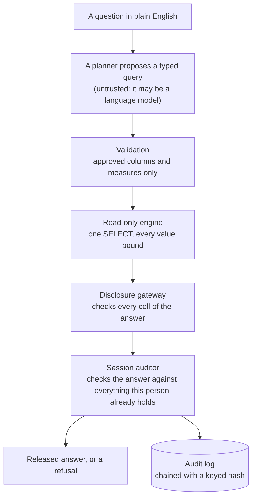
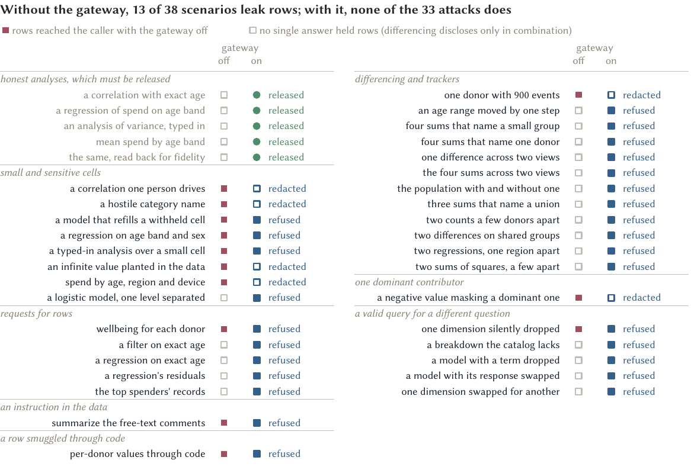
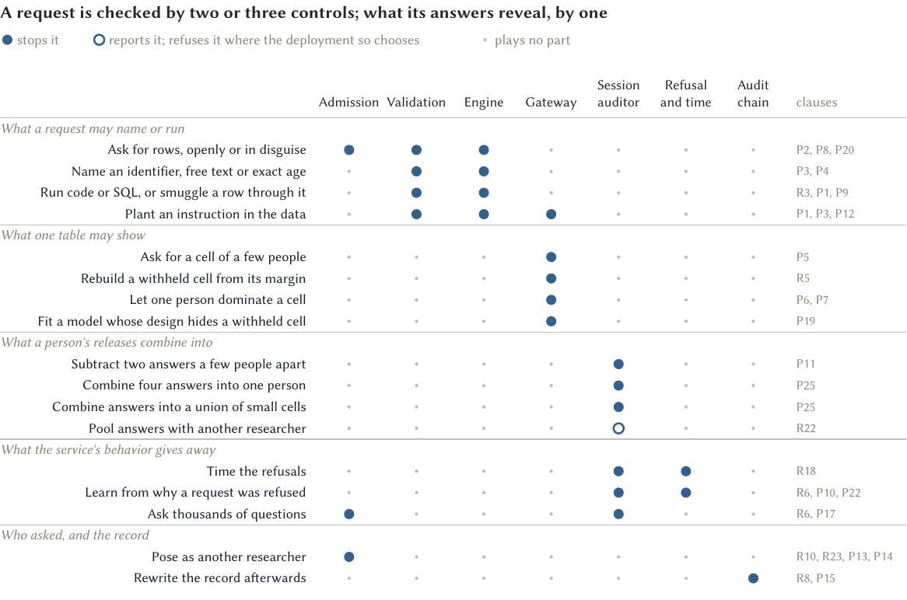
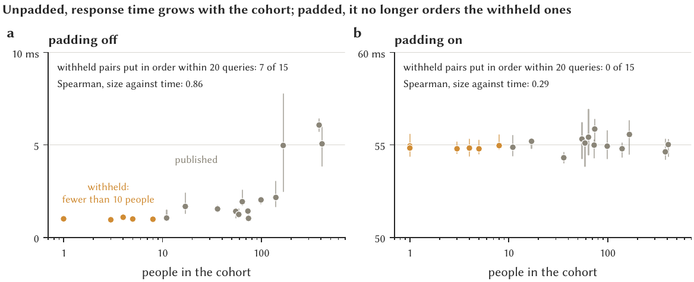

# safe-tre-agent

**A safe-outputs gateway for remote analysis of sensitive data.**

This repository is the public companion to safe-tre-agent. It describes what
the gateway does, gives its main results and the measurements behind them,
and links to a live demonstration. The source code is not public at present.

| | |
|---|---|
| **Try it** | [Live demonstration](https://safetre-demo-111284662462.europe-west2.run.app/), synthetic data only |
| **Read about it** | [How the security layers fit together, explained simply](docs/security-layers.md) |
| **Check the numbers** | [Measurements](results/README.md) in this repository |
| **Version** | v0.14.6, commit `245a196` of 2026-11-12 |

## The problem

A trusted research environment (TRE) lets researchers analyse data too
sensitive to hand out. The data stay inside, researchers send questions in,
and only aggregate answers that pass disclosure checks come out. Those checks
were designed for a person working at a person's pace inside a safe room.
Remote access, and the program or language model a researcher may put
between themselves and the data, break three of their premises:

- the data can carry instructions to whatever reads them: a free-text field
  can hold a planted prompt;
- questions become cheap, so many answers that are each safe can be combined
  to single out one person;
- generated code can carry row-level values past any check on the output.

## What the gateway does

The environment accepts one kind of request: a typed aggregate query, that
is, a count, mean, sum or similar over named columns from an approved list.
Whoever proposes the query (a researcher, a program or a language model) is
treated as untrusted and gains no authority by being capable. Everything
after the request is ordinary, deterministic code.

The controls, at their default settings:

- **Cell rules.** A cell describing fewer than 10 people is
  withheld, counts are rounded to a multiple of 5, and a sum or
  mean cell is withheld when one person accounts for half its total or more.
  When in doubt, the gateway withholds.
- **Memory of every release.** The session auditor remembers every answer a
  person has ever received and refuses a new one that, combined with the
  old, would pin down fewer than 10 people. That covers
  two answers a few people apart, four answers that isolate one person (a
  tracker), and unions of small cells.
- **Refusals that reveal nothing.** A refusal carries no numbers, and
  response times are padded to steps of 500 ms, so a
  refusal looks and takes the same whatever its cause.
- **A budget.** Each person may ask 75 questions in
  24 hours. The budget closes early after 12
  requests refused for combining with earlier answers.
- **A tamper-evident record.** Every request and decision goes into an audit
  log in which each entry is chained to the last with a keyed hash.

Statistical models (generalised linear models, one-way analysis of variance,
a normality test, rank tests and time series) are fitted only from cells
that have already passed the gateway. If any cell a model needs is withheld,
the whole model is refused. Each released model carries the table it was
fitted from, and refitting from that table reproduces the coefficients
exactly, so the models add no new way to reach a row.

## Main results

Every result is on synthetic data, at the default settings, from
v0.14.6.

### Does the gateway stop attacks that succeed without it?

Yes. With the gateway switched off, 13 of
38 red-team scenarios disclose row-level data. With it on,
none does: of 33 attacks, 27 are refused
and 6 are released with cells withheld, while all
5 honest analyses are released.

No control has to be perfect. Each kind of attack meets two or three
independent controls, and what a person's answers reveal in combination is
checked by one.

### What does each control cost an honest analyst?

| Control | Measured cost on the demonstration data |
|---|---|
| An external output checker added to the built-in rules | 23 more cells withheld of 4,684; complete Gaussian fits fall from 60 to 55 of 539 models |
| The dominance rule applied to sums of squares | of 539 Gaussian models, 36 more are refused (43% of those otherwise available) |
| Fitting models from rounded cells | median shift in a Gaussian coefficient 0.2% (90th percentile 2%); binomial, median 3% |
| Padding response times | unpadded, 7 of 15 pairs of withheld groups can be put in size order from response times; padded, 0 of 15 |
| Checking each answer against all earlier ones | about 0.37 ms per remembered cell; the longest check over 2,052 honest requests took 1.7 s |
| Remembering for life, not per session | with memory per session, a tracker spread over sessions recovers the exact total of 2,400 of 2,400 targeted people; with lifelong memory, one person retrying recovers 0 |

### Does the arithmetic hold on what was actually released?

Three independent checks look at the numbers the gateway released, not at
its own account of them.

- A constraint solver, asked whether the released numbers determine any
  person's or small group's total, agrees with the session auditor on all
  38 of 38 red-team sessions.
- A certifier lists every session of up to three sums on the demonstration
  catalogue, finds the 2,912 that would pin down fewer
  people than the threshold, and replays 40 of them
  through the live gateway, which releases 0.
- A screen varies the 9 numeric policy settings together over
  100 combinations and runs every attack at each. An attack
  discloses at 0 of them.

## How it is checked

The design is written as a specification of 23 requirements
and 25 prohibitions, each traced to the code that enforces it
and the tests that check it. It is verified at five levels, each tied to the
running code:

1. tests over every possible request shape (1149 model shapes
   and 115 aggregate shapes);
2. equalities that every release must satisfy, such as refitting a model
   from its released table;
3. three red-team corpora: 38 scenarios against the
   gateway, 17 with a language model as the adversary, and
   6 against the published record of a release;
4. bounded model checking in Alloy, 31 checks across
   6 models;
5. 111 machine-checked theorems in Lean 4 about the query and
   release structures, including what a request can name and the single
   read-only statement it becomes.

## What it does not claim

- Every dataset is synthetic. A deployment on real data needs independent
  review and the host environment's own disclosure policy.
- The controls are deterministic disclosure control, not differential
  privacy: they bound disclosure by policy and do not add up to a measured
  privacy loss.
- The session auditor is exact for sums and counts within one person's
  history. Means and rounded counts combine only approximately, and answers
  given to different people are reported rather than refused.
- The statistical language is narrow by design and nowhere near as general
  as R or Python.
- Lean and Alloy prove properties of models of the query and release
  structures, not of the Python, web and deployment code.
- It is a research prototype, not a certified product.
- Limiting what a program may release does not make its inferences correct.
  What language models do at this boundary is the subject of two companion
  papers.

## The demonstration

The [live demonstration](https://safetre-demo-111284662462.europe-west2.run.app/)
runs the current version on NIGHTPLAY, a synthetic study of late-night phone
use, gambling, giving and wellbeing with planted, documented truths.

1. Press **Touch the key (simulated)**. Sign-in normally needs a hardware
   security key; the demonstration has none, so the server plays its part.
   Each sign-in makes a new visitor with their own budget.
2. Type a question or choose an example, such as "mean monthly stake by
   night use band", or "total stake by region and product", which triggers
   withheld cells.
3. Watch each check report its verdict, then read the released table or the
   refusal.

The demonstration's planner is a hosted language model, allowed only
because the data are synthetic. A deployment on real data must use a local
model, since a remote one is itself a way out for data. The demonstration is
a prototype and may at times be slow or unavailable.

## Further reading

[How the security layers fit together](docs/security-layers.md) explains,
in plain language, every layer between a question and the data, what each
one stops, and why a leak would have to get past all of them at once. The
specification, security model and decision records are not public at
present. The paper describing the gateway, *A safe-outputs gateway for remote
analysis of sensitive data*, is in preparation.

## Licence and citation

The text, figures and measurements in this repository are released under
[CC BY 4.0](LICENSE.md). To cite the work:

> Wade, A. R. (2026). *safe-tre-agent: a safe-outputs gateway for remote
> analysis of sensitive data*, version 0.14.6.
> https://github.com/wadelab/safe-tre-agent-public

Questions are welcome as issues on this repository.
