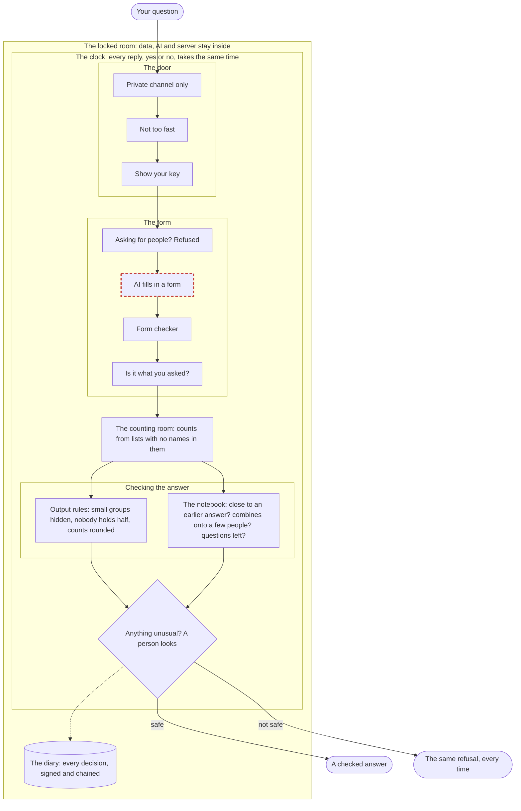
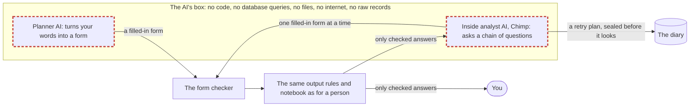
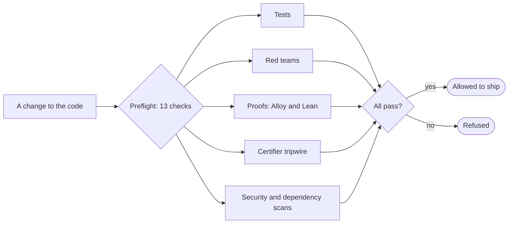

# How the security layers fit together, explained simply

*Copied from the safe-tre-agent documentation for v0.14.6. Most of that documentation is not public, so the names of other documents are plain text and pointers into the source code are left out.*

## TL;DR

A question passes through nine simple layers before any number comes out.
None of them has to be perfect. A leak would have to get past all of them at
once, the way light only gets through a stack of Swiss cheese slices where
the holes happen to line up. Most attacks below meet solid cheese in two or
more layers, so one broken layer does not let them through. The exception is
two people pooling their answers: by default that is only reported, and the
table marks it. The AI sits in one of the layers and is never trusted: it can
only fill in a form, and every form meets the same checks as a person's.

## The whole journey on one page

Read it from the top. Boxes inside boxes wrap the boxes they hold: the locked
room holds everything, and the clock wraps every reply. The dashed red box is
the AI.

The order follows the code. The output rules and the
notebook both look at every answer, and either one can stop it: the
notebook's lineage check looks at the answer's total, and its rank audit
looks at the cells the output rules would let out.

## Each layer, in the order a question meets it

### 1. The locked room

*Like a school that keeps its records in a locked office.*

For real data, the server, the raw records and the AI model sit in one
locked, sealed box (the record calls it a safepod), with spare ports and
radios turned off and the disk encrypted. Only checked answers leave it. The
online demo uses made-up people, so it skips this layer.

**Stops:** someone walking off with the disk, and the AI sending data
anywhere.

### 2. The clock

*Like a teacher who always waits ten seconds before answering, whatever the
answer.*

Every reply, a yes or a no, is held until the same tick of a clock. A refusal
for a hard reason and a refusal for an easy one also do the same amount of
work. So how long a reply takes tells you nothing about the data.

**Stops:** timing the answers to learn which rule fired.

### 3. The door

*Like a school gate with one road in and a badge check.*

Requests must come down the one approved private channel. Ask too fast and
the door asks you to slow down. Then you sign in with your own security key,
and every limit later on is kept for that key.

**Stops:** pretending to be someone else, coming in by a side road, and
flooding the gateway.

### 4. The form (the AI is here)

*Like a translator who may only fill in boxes on a printed form.*

First, a plain check refuses requests for individual records. Then the AI
turns your words into a filled-in form: which list, which measure, which
groups, which filters. It cannot write code or database queries. A strict
form checker accepts only words from a fixed list, and a last check makes
sure the form answers what you actually asked.

**Stops:** asking for names, hidden instructions planted in the data, and the
AI answering a different question.

### 5. The counting room

*Like a clerk who can only read the class lists, never the files.*

Fixed code, never the AI, turns the form into a database query. It reads only
public lists that leave out names, free text, exact times and exact ages, and
it can only read, never change. Filter values travel separately from the
query, so they cannot change what it does.

**Stops:** reading anything not on the public lists, and tricks hidden inside
filter values.

### 6. The output rules

*Like the teacher's rules for what can be said out loud.*

Any cell with fewer than 10 people is hidden. So is any cell where one person
holds half the total or more, or where one person moves a correlation too
much. Counts are rounded to the nearest 5. If a hidden cell could be worked
out from the others, a second cell is hidden too. Anything odd, like a name
or an infinite number, means the cell is hidden or the request refused.

**Stops:** tiny groups, one rich person in a cell, and working out a hidden
cell from a total.

### 7. The notebook

*Like a teacher who writes down every question you have asked.*

The gateway remembers everything it has told you, for as long as you have
access. It refuses an answer that differs from an earlier one by only a few
people (the lineage check). The rank audit checks whether this answer, added
to and taken from all your earlier ones, lands on a few people. You have a
budget of 75 answers a day, and once 12 different requests in a day have
been refused only for combining with your earlier answers, the budget
closes.

A second notebook, the cross-person ledger, does the same across different
people's answers. By default it writes what it finds in the diary for a
checker, rather than refusing; a deployment can set it to hold or refuse.

**Stops:** subtracting one answer from another, longer chains that do the
same, and fishing with many near-copies.

### 8. A person

*Like asking the head teacher when something does not fit the rules.*

Anything unusual that the rules did not settle goes to a human output checker
before it can leave. Every refusal you see looks the same, so you cannot tell
which rule said no.

**Stops:** the cases nobody wrote a rule for, and learning from the wording of
a refusal.

### 9. The diary

*Like a diary written in ink, where each page carries a seal made from the
page before.*

Every decision, with its real reason, is written to a log. Each entry is
signed with a key, which a real deployment keeps away from the data machine,
and chained to the entry before, so a page cannot be changed, removed or torn
off the end without the chain breaking. After a restart, your budget and
history are rebuilt from it.

**Stops:** changing the record afterwards, and getting a fresh budget by
waiting for a restart.

## Follow a question through

The first four are real results: each was run through the real service on
the made-up data the repository ships (seed 7, 800 people). The fifth is the
web layer's rate limit. Around every step, the locked room holds everything
inside and the clock holds every reply to the same beat.

**"What is the average spend in each age band?"** You are signed in with
your key, on the private channel. The AI fills in: average of amount spent,
grouped by age band; the checker accepts it, and it matches what you asked.
It is counted from the spending list. All six age bands have at least 10
people and nobody holds half. It is not close to anything you asked before,
and it combines onto nobody. *Released:* all six age bands.

**"List the donors in Wales and what each one spent."** The intent check
refuses a request for individual records, and even past it, the form has no
box for names. Nothing is counted. The refusal and its real reason go in the
diary. *Refused,* with the standard message.

**"Total spend by age band and genre in the East Midlands."** The form is
filled in and counted as usual, into 42 cells. 25 of them have fewer than 10
people and are hidden. Of the 17 big enough, 11 have one person holding half
the total or more, and are hidden too. One of those, 35 to 49 year-olds
playing RPGs, has 11 people and one of them holds exactly half; it is hidden
in every run. The diary records which cells were hidden and why. *Released
with 36 of 42 cells hidden,* the same six cells shown every time.

**The fourth of four tracker questions.** You ask for everyone's total
spend, then the total without 13 to 15 year-olds, then the total without the
East Midlands. Each is a big group, and each is released. Then you ask for
the total without both. That is a big group too, so the form and the output
rules see nothing wrong. But added to and taken from your three earlier
answers, it gives the total for 13 to 15 year-olds in the East Midlands:
three people. The rank audit finds this and refuses whichever of the
four questions comes last. It also counts as one of your 12 allowed refusals
of this kind. *Refused,* with exactly the same message as any other refusal.

**The same question 50 times a second.** The door allows about 120
requests a minute for each person. Within three seconds the program has used
them up, and from then on the door asks it to slow down, and nothing past
the door runs. *Slowed down;* even this reply waits for the clock.

## Why the holes do not line up

Each column is a slice of cheese, one layer. A tick means that layer stops
the attack in that row; a blank is a hole. An attack gets out only if it
finds a hole in every slice.

| Attack | Room | Clock | Door | Form | Counting | Rules | Notebook | Person | Diary |
|---|:-:|:-:|:-:|:-:|:-:|:-:|:-:|:-:|:-:|
| Show me the names | | | | ✓ | ✓ | ✓ | | | |
| Run my own code or database query | | | | ✓ | ✓ | | | | |
| A note planted in the data tells the AI to leak | | | | ✓ | ✓ | | | | |
| Ask about a group of three people | | | | | | ✓ | ✓ | | |
| One rich person in a cell | | | | | | ✓ | | | |
| Subtract one answer from another | | | | | | ✓ | ✓ | | |
| Time how long refusals take | | ✓ | | | | | ✓ | | |
| Pretend to be someone else | | | ✓ | | | | | | |
| Ask thousands of questions | | | ✓ | | | | ✓ | | |
| Two people pool their answers | | | | | | | (✓) | (✓) | |
| Change the record afterwards | ✓ | | | | | | | | ✓ |
| Walk off with the disk | ✓ | | | | | | | | |

How each tick works:

- **Names.** The intent check refuses the request and the form has no box for
  names; the public lists have no names in them; a last check refuses any
  answer that carries a name or free text.
- **Own code.** The AI can only fill in the form, and fixed code writes the
  query; filter values travel separately, and the database is read-only.
- **A planted note.** The AI can only fill in a form, whatever it reads, and
  free text is not in the public lists, so the note is never read back.
- **A group of three.** Any cell with fewer than 10 people is hidden, and the
  rank audit catches small groups built from several answers.
- **One rich person.** A cell where one person holds half or more is hidden,
  the same way every time.
- **Subtracting.** A second cell is hidden when a hidden one could be worked
  out from a total; the lineage check and the rank audit refuse answers that
  differ by a few people, and refusals of that kind are limited.
- **Timing.** Every reply leaves on the same tick, and a refusal does the same
  work as a release.
- **Pretending.** Only the private channel is accepted, and you sign in with
  your own security key.
- **Thousands of questions.** The rate limit slows you down, and the budget
  runs out, kept for your key.
- **Two people pooling.** The thinnest row: its ticks are in brackets
  because they hold only where a deployment turns them on. The cross-person
  ledger notices when answers to different people combine onto a few people,
  but by default it only writes this in the diary for a checker. A deployment
  can make it hold the answer for a person, or refuse it. The security model
  lists collusion as a known residual.
- **Changing the record.** Every page is sealed to the one before, and the key
  and the latest seal are kept off the data machine.
- **The disk.** The locked, sealed box, with the disk encrypted. Real data
  need it; the online demo has none.

## Where the AI sits

There are two AIs. The planner turns your words into a form. The inside
analyst, called Chimp, can ask a chain of questions for you. Both live in a
box with one way out: a filled-in form, checked by the same rules as a
person's. Neither ever sees a raw record.

One step needs extra care. When a model is refused because one group is too
small, Chimp may drop that group and try again. But which group was too small
is itself a secret. So Chimp must seal its whole retry plan in the diary
before it looks, plain code runs the plan, and each such look is paid for
from a small budget.

The safety never depends on the AI being good or bad. A hijacked AI can
still only fill in forms, and every form meets the same layers.

## The checks that run before any change ships

The layers above work while you ask. A second set of checks runs whenever the
code changes. Before code is pushed to the main copy, a preflight script
runs all of them and refuses the push if any fails, and the shared build runs
them again after every push.

- **Three red teams** attack it on purpose. One shapes sneaky queries at the
  gateway. One makes the AI the attacker. One takes a published research
  record and checks it gives away nothing the gateway held back.
- **Alloy** tries every small world it can build and shows any that breaks a
  rule. **Lean** proves rules hold in every case. Parts of both are generated
  from the code, and a test fails if the two drift apart.
- **The policy screen** tries the gateway at 100 settings of its dials at
  once, to find settings that are only unsafe together.

| | |
|---|---|
| Tests in the default suite | 1,955 |
| Hardening findings logged, each with what was done | 132 |
| Recorded decisions, each with its reasons | 27 |
| Policy settings screened together | 100 |

## Words in the docs

| Word | Means |
|---|---|
| safepod | the locked room |
| response-time boundary | the clock |
| restricted channel | the one road in, at the door |
| `QuerySpec` | the form the AI fills in |
| intent vetting | the plain check that refuses requests for records |
| disclosure gateway | the output rules |
| session auditor | the notebook |
| lineage | the notebook's check against each earlier answer |
| rank audit | the notebook's check against every combination of earlier answers |
| probe limit | how many refusals of that kind are allowed before the budget closes |
| cross-person ledger | the second notebook, across different people |
| canonical refusal | the one refusal message every refusal uses |
| HMAC chain | the seals that link the diary's pages |
| Chimp | the inside analyst AI |
| red team | people or programs that attack the system on purpose |
